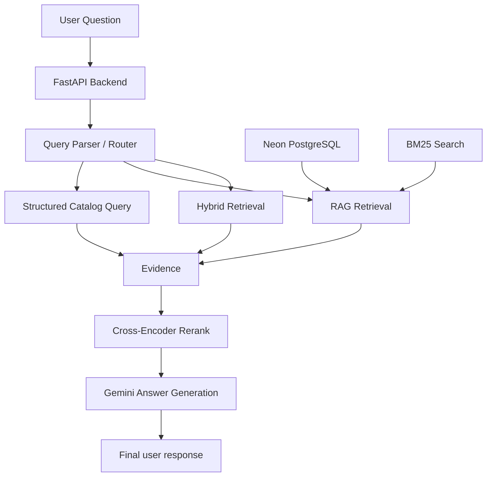

# AcmeFlow

AcmeFlow is an AI-powered product assistant that answers natural-language questions using both structured catalog data and knowledge-base retrieval. It combines FastAPI, PostgreSQL (Neon), and Google Gemini to support product search, document-grounded Q&A, and hybrid reasoning across product data and supporting knowledge.

## Overview

The application is built to answer user questions such as:

- Find products with a rating above a certain threshold
- Show variants that are out of stock
- Look up products by brand, category, ID, or SKU
- Explain a refund or cancellation policy using the knowledge base
- Combine catalog filters with policy explanations in a hybrid answer

The backend classifies each question into one of three modes:

- Structured: answerable from the Excel product catalog
- RAG: requires knowledge-base document retrieval
- Hybrid: requires both catalog data and knowledge-base content

## Features

- FastAPI-based backend API
- Query parsing and route selection
- Structured product filtering using pandas and Excel data
- Retrieval using BM25 keyword search
- Embedding-based semantic retrieval with Gemini embeddings
- Reciprocal Rank Fusion (RRF) to merge retrieval lists
- Cross-encoder reranking for higher-quality results
- Final response generation with Gemini
- PostgreSQL knowledge base with vector similarity queries
- Swagger/OpenAPI documentation via FastAPI

## Tech Stack

- Python
- FastAPI
- Uvicorn
- Pandas
- PostgreSQL (Neon)
- Google Gemini API
- rank-bm25
- sentence-transformers
- CrossEncoder reranking
- dotenv
- Excel-based product catalog

## Architecture



## Repository Structure

```text
AcmeFlow/
├── backend/
│   ├── main.py
│   ├── parse_input.py
│   ├── structure_data.py
│   ├── rag_data.py
│   ├── generate_answer.py
│   ├── gemini_models.py
│   ├── db_connection.py
│   ├── ingestion.py
│   ├── render_markdown.py
│   ├── requirements.txt
│   ├── AcmeFlow_Synthetic_Product_Catalog.xlsx
│   └── ...
├── .github/
│   └── workflows/
├── README.md
├── .env
└── .gitignore
```

## How the App Works

### 1. Query parsing and routing

The backend receives the user query and sends it to `parse_input.py`, which decides whether the request is best answered by:

- `structured`
- `rag`
- `hybrid`

This routing logic is important because catalog products and support documents are different data sources and should not be mixed unless the question truly requires both.

### 2. Structured retrieval

For catalog questions, the app uses the `structure_data.py` layer to filter the product workbook by conditions such as:

- product IDs
- variant IDs
- SKU values
- price thresholds
- rating thresholds
- stock status
- category and brand filters

### 3. RAG retrieval

For policy or knowledge-based questions, `rag_data.py` retrieves relevant knowledge-base chunks using a combination of:

- BM25 keyword search
- embedding similarity search
- reciprocal rank fusion (RRF)
- reranking using a CrossEncoder

This makes the retrieval step better aligned with the user’s intent.

### 4. Answer generation

After evidence is collected, the app calls Gemini to generate a human-readable answer grounded in the retrieved data. The final response is intended to be concise and factual, without exposing internal routing logic.

## Prisma of the environment

This project expects a `.env` file with at least the following values:

```env
DATABASE_URL=postgresql://<user>:<password>@<host>:<port>/<database>?sslmode=require
GEMINI_API_KEY=your_google_gemini_api_key
```

For the current setup, the database is hosted on Neon PostgreSQL, and the LLM/embedding layer uses Google Gemini.

## Database notes

The backend uses a PostgreSQL database for the knowledge base. It stores chunks of content and their embeddings so that semantic similarity queries can locate the most relevant information.

The main retrieval logic in `db_connection.py` queries records from the `knowledge_base` table and compares embeddings using vector distance.

## Installation

Create a virtual environment and install dependencies:

```bash
python -m venv .venv
source .venv/bin/activate   # Windows: .venv\Scripts\activate
pip install -r backend/requirements.txt
```

## Running the API locally

From the repository root:

```bash
cd backend
uvicorn main:app --reload
```

Then open:

```text
http://127.0.0.1:8000
```

FastAPI also exposes automatic docs at:

```text
http://127.0.0.1:8000/docs
```

## API endpoint

### POST /api/

Request body:

```json
{
  "query": "Find products under 25000 PKR with good reviews"
}
```

The endpoint returns a final answer generated from the structured or retrieved evidence.

## Key backend files

- `main.py` — FastAPI app and endpoint definitions
- `parse_input.py` — LLM-based query routing logic
- `structure_data.py` — filter logic for catalog data
- `rag_data.py` — BM25 + embedding retrieval pipeline
- `generate_answer.py` — final answer-generation orchestration
- `gemini_models.py` — Gemini embedding and generation wrappers
- `db_connection.py` — PostgreSQL connection and knowledge-base retrieval
- `ingestion.py` — data ingestion helpers for embeddings and chunk loading
- `render_markdown.py` — markdown-to-text conversion for final output

## Security considerations

- Store secrets in environment variables
- Never commit `.env` files or API keys to Git
- Keep database credentials secure
- Use least-privilege access for the Neon database
- Avoid exposing sensitive internals in API responses

## Notes

- The Excel catalog file is loaded at startup from `backend/AcmeFlow_Synthetic_Product_Catalog.xlsx`.
- The knowledge base is expected to be populated before running the RAG pipeline.
- Some ingestion scripts can be used to populate the vector database and knowledge chunks as needed.
- Model initialization can take time on first load, especially when using Gemini and embedding models.

## License

This project does not currently include a license file. If you plan to distribute or publish the repository publicly, add a license before doing so.

## Next steps

- Add automated tests for routing and retrieval correctness
- Improve documentation for the expected knowledge-base schema
- Add a proper ingestion script and database setup guide
- Add production deployment instructions for Neon + FastAPI + Gemini

